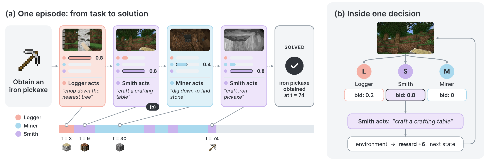

# Learning Self-Orchestration in Decentralized Agent Swarms

<p align="center">
  <a href="https://guoweixu.com/mpt/"></a>
  <a href="https://arxiv.org/abs/PLACEHOLDER"></a>
  
  <a href="LICENSE"></a>
</p>

## Overview

The capabilities of an agent swarm depend on both its individual members and how they coordinate. Yet existing multi-agent systems often train agents within **fixed orchestration structures**, separating the learning of individual capabilities from the organization of collective behavior.

We introduce **market-based post-training (MPT)**, a framework for jointly learning **action policies** and **self-orchestration** in decentralized agent swarms. Agents express their willingness to participate through **bids**, which determine who acts and how collective outcomes provide local training credit. Learning both action and bidding behavior lets individual capabilities and patterns of participation adapt together, without a central coordinating agent. We evaluate MPT on embodied crafting, robot navigation, and deep research.

<p align="center">
  
</p>

## Experiments

Each setting is a swarm of three agents that share one environment. Each agent may only emit its own slice of the action space, so no agent can solve the task alone. Each turn, the agents bid and the highest bidder acts.

| Setting | Environment | Base model | Agents |
|---|---|---|---|
| Embodied Crafting | Minecraft iron pickaxe | Qwen3-VL-4B-Instruct | Logger, Miner, Smith |
| Robot Navigation | VLN-CE R2R | NaVILA-8B | Turner, Mover, Stopper |
| Deep Research | OpenResearcher corpus | gemma-4-E2B-it | Searcher, Opener, Finder |

## Trained Models

All checkpoints are on the Hugging Face Hub. *single* is one monolithic agent trained with REINFORCE. *society* is the three-agent swarm trained with MPT. A society repository has one subfolder per agent.

| Setting | Arm | Stage | Repository |
|---|---|---|---|
| Embodied Crafting | single | RL | [`Xkev/mc_single`](https://huggingface.co/Xkev/mc_single) |
| Embodied Crafting | society | MPT | [`Xkev/mc_society`](https://huggingface.co/Xkev/mc_society) |
| Robot Navigation | single | RL | [`Xkev/navila_single`](https://huggingface.co/Xkev/navila_single) |
| Robot Navigation | society | MPT | [`Xkev/navila_society`](https://huggingface.co/Xkev/navila_society) |
| Deep Research | single | RL | [`Xkev/deepresearch_single`](https://huggingface.co/Xkev/deepresearch_single) |
| Deep Research | society | MPT | [`Xkev/deepresearch_society`](https://huggingface.co/Xkev/deepresearch_society) |


## 1. Install

Set up CUDA, PyTorch and flash-attn following the [verl installation guide](https://verl.readthedocs.io/en/latest/start/install.html). Each setting then needs one trainer env and one environment-service env:

| Setting | Trainer env | Environment service env |
|---|---|---|
| Embodied Crafting | `pip install -r requirements_sglang.txt && pip install -e . --no-deps` | `minestudio==1.1.6`, JDK 8, `xvfb-run` (see `configs/mc_env.sh.example`) |
| Robot Navigation | as Embodied Crafting, then `python scripts/install_navila_sglang_shims.py --env <trainer-env>` | habitat-sim 0.1.7 and the NaVILA `evaluation/` tree with Matterport3D scenes and R2R-CE data |
| Deep Research | the four install steps in the header of `requirements_deepresearch.txt` | JDK 21, `pip install "git+https://github.com/texttron/tevatron.git" && pip install -r requirements_search_service.txt` |

`configs/env.example.sh` lists every environment variable the scripts read. Set `MPT_WORK` to large storage and `MPT_CONDA_ENV` to the trainer env. 

## 2. Data

`data/` contains the training worlds and the three test sets.

```
data/
├── minecraft/
│   ├── train.parquet
│   └── val.parquet
├── navila/
│   └── val.parquet
└── deepresearch/
    └── val.parquet
```


## 3. Train

As an example, we use the SFT cold-start checkpoints of Embodied Crafting: the three-agent swarm [`Xkev/mc_society_sft`](https://huggingface.co/Xkev/mc_society_sft) and the single agent [`Xkev/mc_single_sft`](https://huggingface.co/Xkev/mc_single_sft). MPT training starts from the SFT swarm:

```bash
huggingface-cli download Xkev/mc_society_sft --local-dir /path/to/mc_society_sft
```

First start Minecraft env servers:

```bash
MINESTUDIO_DIR=/path/to/minestudio MC_SIM_ENV=/path/to/envs/minestudio MC_SLOTS=10 \
  bash scripts/start_mc_env.sh
```

Then launch the trainer:

```bash
MPT_CONDA_ENV=/path/to/envs/trainer MPT_WORK=/path/to/work \
MC_ENV_URL=http://<env-host>:31500 MC_SFT_DIR=/path/to/mc_society_sft \
  bash scripts/train_mc_mpt.sh
```

`MC_ENV_URL` must name exactly one env server.

## 4. Evaluation

Download the released swarm for the setting you want to evaluate:

```bash
huggingface-cli download Xkev/mc_society           --local-dir /path/to/mc_society
huggingface-cli download Xkev/navila_society       --local-dir /path/to/navila_society
huggingface-cli download Xkev/deepresearch_society --local-dir /path/to/deepresearch_society
```

Each script plays every instance `RUNS` times (default 3), sampling at temperature 1.0.

### Embodied Crafting

```bash
# 1. one or more Minecraft env servers
MINESTUDIO_DIR=/path/to/minestudio MC_SIM_ENV=/path/to/envs/minestudio MC_SLOTS=4 \
  bash scripts/start_mc_env.sh

# 2. one sglang server per agent on one GPU
MPT_CONDA_ENV=/path/to/envs/trainer MPT_WORK=/path/to/work MC_MODEL_DIR=/path/to/mc_society \
  bash scripts/serve_mc_agents.sh

# 3. evaluate the seeds
MPT_CONDA_ENV=/path/to/envs/trainer MPT_WORK=/path/to/work \
MC_ENV_URL=http://<env-host>:31500 RUNS=3 \
  bash scripts/eval_mc.sh
```


### Robot Navigation

```bash
# 1. habitat env server on the val_unseen split
NAVILA_EVAL_DIR=/path/to/NaVILA/evaluation NAV_SIM_ENV=/path/to/envs/habitat \
NAV_SPLIT=val_unseen NAVILA_SLACK=0 NAV_SLOTS=24 NAV_PORT=31601 \
  bash scripts/start_navila_env.sh

# 2. evaluate the episodes
MPT_CONDA_ENV=/path/to/envs/trainer MPT_WORK=/path/to/work \
NAV_MODEL_DIR=/path/to/navila_society NAVILA_ENV_URL_VAL=http://<env-host>:31601 \
  bash scripts/eval_navila.sh
```


### Deep Research

```bash
# 1. search service: corpus, Lucene jars, BM25 index, then serve
export HF_HOME=/path/to/hf_cache OR_WORK_ROOT=/path/to/or_work JAVA_HOME=/path/to/jdk21 OR_SERVICE_ENV=/path/to/envs/search
bash scripts/download_or_corpus.sh
bash scripts/download_or_jars.sh
OR_PROVISION=1 bash scripts/build_or_bm25_index.sh
bash scripts/start_or_search_service.sh 8000

# 2. evaluate the questions
MPT_CONDA_ENV=/path/to/envs/trainer_deepresearch MPT_WORK=/path/to/work \
DR_MODEL_DIR=/path/to/deepresearch_society OR_SERVICE_URL=http://<service-host>:8000 \
JUDGE_API_BASE=https://<openai-compatible-endpoint> JUDGE_API_KEY=<key> \
  bash scripts/eval_deepresearch.sh
```


## Citation

If you find MPT and our prior work EoM useful in your research, please consider citing our papers.

```bibtex
@article{xu2026mpt,
  title   = {Learning Self-Orchestration in Decentralized Agent Swarms},
  author  = {Xu, Guowei and Qi, Zhenting and Kiruga, Amani and Lakkaraju, Himabindu and Du, Yilun},
  journal = {[venue]},
  year    = {[year]}
}

@inproceedings{qi2026economy,
  title     = {Economy of Minds: Emerging Multi-Agent Intelligence with Economic Interactions},
  author    = {Zhenting Qi and Huangyuan Su and Ao Qu and Chenyu Wang and Yu Yao and Han Zheng and Kushal Chattopadhyay and Guowei Xu and Zihan Wang and Weirui Ye and Vijay Janapa Reddi and Ju Li and Paul Pu Liang and Himabindu Lakkaraju and Sham M. Kakade and Yilun Du},
  booktitle = {Workshop on Scientific Understanding of Foundation Models},
  year      = {2026},
  url       = {https://openreview.net/forum?id=Oznkw4Uncb}
}
```
